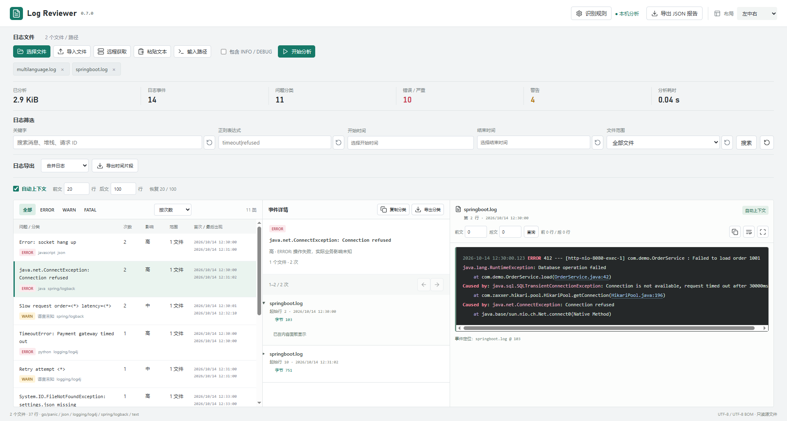

# Log Reviewer

[](https://github.com/DXShelley/log-reviewer/actions/workflows/ci.yml)
[](https://github.com/DXShelley/log-reviewer/actions/workflows/delivery.yml)

[下载发行版](https://github.com/DXShelley/log-reviewer/releases) · [查看源码（dev）](https://github.com/DXShelley/log-reviewer/tree/dev) · [文档中心](docs/README.md) · [参与开发](CONTRIBUTING.md) · [安全报告](SECURITY.md)

仓库默认 `main` 提供项目介绍和使用文档；完整 Go 源码、开发脚本和测试位于 `dev`，贡献代码请提交到 `dev`。可执行文件仅通过 GitHub Releases 分发，`dist/`、缓存和测试输出不得提交到任何分支。

当前版本 **v1.0.0**：整合统一 GUI 设置、本机与 SFTP 只读分析、跨入口内容去重及上传副本保护，完善安全访问与导出工作流；详见 [变更记录](docs/CHANGELOG.md)。

v0.7.0 增加离线 Highlight.js 日志着色、Lucide 图标、按功能分组的界面，以及基于堆栈与请求证据的自动上下文。布局选择移到右上角，单条手动上下文仍优先。详见 [工作区与时间导出](docs/workspace-usage.md)，验证见 [v0.7.0 记录](docs/VALIDATION-0.7.0.md)。

实用、简洁的本地日志分类工具。单个二进制同时提供 terminal 和浏览器 GUI，无需安装运行时、数据库或日志平台。日志不会发送到云端。

## 实际效果



多文件分析后的左中右布局：左侧展示错误分类和统计，中间查看同类事件，右侧浏览完整堆栈和上下文。截图来自 v0.7.0，当前版本为 v1.0.0。

## 文档导航

- [项目状态与维护入口](docs/PROJECT_STATUS.md)：当前交付、代码入口、验证与已知限制。
- [工作区与时间片段导出](docs/workspace-usage.md)：布局、折叠事件、上下文、全屏、多节点日志片段。
- [服务器访问](docs/server-usage.md) / [SFTP 获取](docs/sftp-usage.md)：无 GUI 环境、监听地址、端口、远程日志与信任目录。
- [独立语言识别规则](docs/language-rules.md) / [Agent API](docs/AGENT_API.md)：规则扩展、JSON 与 HTTP 接入。
- [版本记录](docs/CHANGELOG.md) / [v0.7.0 验证](docs/VALIDATION-0.7.0.md) / [性能基准](docs/VALIDATION.md)。

## 直接使用

筛选区域提供关键字、正则、时间、文件范围的独立重置和全部重置。时间弹窗选择日期、时、分、秒后点“确认”提交，点“取消”保留原值。结束时间包含所选秒内的全部日志。GUI 使用浏览器所在时区；CLI 的无时区时间使用运行机器的本地时区。

“导入文件”支持一次选择多个文件或整个目录，也支持拖入多个文件。“输入路径”直接读取工具所在机器上的日志。“粘贴文本”可添加复制的日志内容，这些输入可以混合分析。

GUI 的本地路径、上传及远程获取按 SHA-256 内容去重，相同内容只保留一份。内容不同但同名时，可替换分析列表中的条目、保留并重命名或取消；直读源文件不会被覆盖或改名。内容校验需完整读取文件，大文件及远程文件导入会增加读取耗时，详见 [工作区说明](docs/workspace-usage.md)。

Windows 从 GitHub Releases 下载并双击 `log-reviewer-windows-amd64.exe`，自动打开浏览器。以下命令中的 `dist/` 仅表示本地构建或下载文件的存放位置。选择分类后，事件默认折叠，点击摘要读取完整事件、堆栈与上下文。GUI 默认启用自动上下文，总体前 20、后 100 行作为扫描上限，可设置为 0–10000 行；关闭自动模式则按指定行数读取。单条事件可独立覆盖。关键字/正则以首次匹配行为中心，无文本搜索时以完整事件为中心。布局与总体设置保存在浏览器中。

分类前的复选框标记已解决，会话期间保留状态（包括刷新、筛选和排序）。详情头部随内容滚动保持可见；双击着色的文件名与行号可完整选中并复制。在详情中按 Ctrl+F 或点击搜索图标打开查找条，支持大小写、正则和前后匹配；Enter / Shift+Enter 切换匹配，Escape 关闭查找。全屏仅占满浏览器内容区域。

“高亮关键字”独立于筛选条件，打开任意事件时会自动作为详情查找词，支持上一个、下一个匹配。事件摘要紧凑显示起止行、起止时间和唯一定位标识 `S文件序号@起始字节+长度`，悬停可查看完整源文件与字节范围（左闭右开）。没有独立结束时间的堆栈沿用事件内最后一个已知时间，不使用下一事件的时间。

同一级别、logger、语言和归一化根因下，调用栈按规范化空白后的帧序列精确匹配，保留方法、文件名、行号和调用顺序，忽略十六进制运行时地址。不同调用栈分为不同分类，以稳定的“分类 N”序号区分。旧报告需重新分析以应用新的分类规则。

Linux / macOS 使用对应平台的文件，先执行 `chmod +x log-reviewer-*`，然后运行。GUI 使用系统浏览器；terminal 在无图形环境中也可用。

界面支持：多文件和目录导入、直接输入路径/通配符、级别/文件/时间/关键字/正则过滤、按次数/影响/最后时间排序、分类与内容复制、分类导出和 JSON 报告导出。Windows 本机导入使用系统选择器直接读取源路径；其他系统本机访问时引导输入路径。远程浏览器上传会产生临时副本；正常 SFTP 分析直接只读，仅网络错误触发对应文件的缓存重试。详见 [读取方式与测试边界](docs/readonly-testing.md)。

示例：

```powershell
.\dist\log-reviewer-windows-amd64.exe gui .\samples\springboot.log .\samples\multilanguage.log
.\dist\log-reviewer-windows-amd64.exe analyze --out report.json "D:\logs\*.log"
.\dist\log-reviewer-windows-amd64.exe query --report report.json --level ERROR
.\dist\log-reviewer-windows-amd64.exe query --report report.json --keyword "Connection refused" --details
.\dist\log-reviewer-windows-amd64.exe query --report report.json --group <分类ID> --details --auto-context --before 20 --after 100
.\dist\log-reviewer-windows-amd64.exe query --report report.json --from "2026-10-14T12:30:00+08:00" --to "2026-10-14T13:00:00+08:00"
.\dist\log-reviewer-windows-amd64.exe export --report report.json --group <分类ID> --out errors.txt
.\dist\log-reviewer-windows-amd64.exe export-time --report report.json --from "2026-10-14T12:30:00+08:00" --to "2026-10-14T12:35:00+08:00" --out nodes.txt
.\dist\log-reviewer-windows-amd64.exe export-time --report report.json --from "2026-10-14T12:30:00+08:00" --to "2026-10-14T12:35:00+08:00" --out-dir nodes-period
```

时间片段导出保留同一时段的普通日志与续行堆栈，按报告文件顺序合并或分别生成文件；不受 ERROR/WARN 分类、关键字和正则条件限制。`export-time` 的输出文件或目录必须尚不存在。GUI 分文件导出为 ZIP。

所有参数放在文件路径之前。`analyze` / `query` 将 JSON 写入 stdout，提示和错误写入 stderr，错误时 exit code 为 1。指定目录时读取当前层 `.log`、`.log.*`、`.txt` 文件；也可直接指定任意扩展名的普通文本文件。重复路径自动去重。

## 内置识别与分类

识别以实际日志格式为准，而不是只根据文件扩展名猜测语言：

| 常见来源 | 支持内容 |
| --- | --- |
| Java / Spring Boot / Logback / Log4j | ISO/本地时间、级别、logger、连续堆栈、深层 `Caused by` |
| Python logging | 逗号毫秒时间、WARNING、logger、traceback；裸 traceback 也可识别 |
| Node.js Pino / Winston | JSON level/msg/time、数字级别、嵌套 err.stack |
| Go slog / logrus / zap | 文本 / JSON、秒或毫秒时间、panic 多行堆栈 |
| .NET Serilog / Microsoft logging | JSON / compact JSON、Error/Warning、fail/warn、异常堆栈 |
| Rust tracing / 常见 C/C++ 日志 | ISO 时间、ERROR/WARN、glog 的 E/W 前缀 |
| Nginx 等系统日志 | 年/月/日时间、括号 error/warn；无年份的 syslog 时间需自定义规则 |

默认收集 WARN、ERROR、FATAL，界面复选框或 `--all` 可纳入 INFO / DEBUG / TRACE。首尾时间按日志时间统计；无可识别时间的事件标记为「时间未知」，时间范围筛选会排除这些事件。

分类指纹由级别、logger 和归一化根因/消息组成。优先采用最后一层 `Caused by`；屏蔽 UUID、长十六进制 ID、数值及常见耗时单位，合并同类不同订单/请求。数字错误码也可能被归一化，必须结合原始事件判断；分类是定位辅助，不是根因证明。

影响程度由级别给出透明的启发式评级：WARN 中、ERROR 高、FATAL 严重。影响范围统计实际出现的文件和 logger/service，**不推断受影响用户数或业务损失**。

## 动态添加格式

GUI「识别规则」按语言分别列出，可编辑、保存、恢复某种语言的规则，或添加自定义语言。自动识别文件中的一种或多种语言，规则修改后重新分析生效。完整说明见 [语言规则](docs/language-rules.md)。通用日志头规则在独立折叠区编辑 JSON，也可使用：

```powershell
.\dist\log-reviewer-windows-amd64.exe analyze --rules .\samples\rules.json --out report.json custom.log
```

规则采用 Go 正则，必须有 `level` 和 `message` 命名组，可增加 `time`、`logger`；`time_layout` 使用 Go 时间模板（例如 `2006/01/02 15:04:05`）。自定义规则优先于通用文本识别；JSON 内置识别先执行。不需要重新编译。

## Agent 对接

稳定的 JSON stdout、带 schema 的报告、本机 HTTP API 和事件字节位置可以直接用于 agent。报告包含根因候选、分类次数、首尾时间、来源文件和每类最多 3 个样本位置。接入方法见 [docs/AGENT_API.md](docs/AGENT_API.md)。

## 大文件与边界

- 流式扫描，不把整份日志加载进内存。40 字节/匹配事件的索引写入磁盘；100 万事件约 38.2 MiB 索引。需要足够的可写缓存空间。
- 无固定的输入文件大小上限；已实测 10GiB 文件。性能记录见 [docs/VALIDATION.md](docs/VALIDATION.md)，结果受磁盘、格式、堆栈长度、唯一分类数量影响，不保证任何输入都能 10 秒完成。
- GUI 每页 10 条折叠摘要，每条最多读取前 4 KiB 提取请求 ID；展开后正文及各方向上下文分别有 2 MiB 显示上限。terminal `query --details` 每页最多 100 条。完整事件可通过导出获取。
- 每条事件使用前 64 KiB 构造指纹，并额外保留可识别的深层 Java cause。超长事件可能归入较粗的分类。分类上限 100,000，超出明确报错，不悄悄丢弃。
- UTF-8 / UTF-8 BOM、LF / CRLF；ANSI 颜色在识别时移除，导出保留原文。UTF-16、gzip 需要先转换/解压，初版会明确拒绝。
- 关键字匹配完整事件，忽略大小写；正则逐物理行匹配，单行最多 1 MiB，超出明确报错。使用 Go RE2 语法，不支持反向引用和 lookbehind。
- 正在写入的活动日志先复制为稳定快照。扫描及详情读取会检查文件大小和修改时间；变化后要求重新分析，不使用过期字节位置。
- GUI 默认监听 `0.0.0.0` 并尝试 IPv6，优先 HTTPS，带每次启动生成的 session token；仅本机可用 `--host 127.0.0.1`。默认持久化自签名证书，首次浏览器访问需确认信任；支持 `--tls-cert` / `--tls-key` 指定受信任证书。Chrome / Edge 在安全上下文可流式保存大导出；其他情况下大于 256 MiB 的导出请用 terminal。
- 报告和 `.idx` 都要保留，源文件位置不可移动；它们是本机可复用的索引，不是完整日志副本。GUI 默认退出后清理会话缓存，`--keep-cache` 可保留。
- GUI 默认 HTTPS 端口 8766（`--https-port`），兼容 HTTP 端口 8765（`--port`）；`--http=false` 可关闭明文入口。端口被占用时自动选择空闲端口，以启动输出为准。关闭浏览器不会关闭服务，在控制台按 Ctrl+C 退出。

## 开发与构建

构建需要 Go 1.25+，SFTP 使用 pkg/sftp 与 x/crypto/ssh，版本锁定在 go.mod/go.sum。运行仍是独立二进制，CGO 关闭。源码、文档、测试、样例、脚本都在 `dev` 分支；`main` 为交付说明面。第三方许可见 [依赖说明](docs/THIRD_PARTY_NOTICES.md)。

开发前执行 `git switch dev`。`main` 只包含交付说明、样例和维护入口；六个平台二进制仅通过 GitHub Releases 分发。

```powershell
go test ./...
go vet ./...
.\scripts\build.ps1 -AllPlatforms
```

Linux / macOS 可运行 `sh scripts/build.sh`。产物覆盖 Windows / Linux / macOS 的 amd64 和 arm64；`CGO_ENABLED=0`，无需外部动态库。

实测生成工具：`go run ./tools/bench --dir <有足够空间的临时目录> --gib 1`，或加 `--dense` 生成全 ERROR 日志。生成的文件是真实写入的日志，不是稀疏文件。

GUI 自动验证：配置 `NODE_PATH` 指向已有 Playwright 包，运行 `node tests/gui-smoke.cjs`；连接 `127.0.0.1:9222` Chrome，创建独立浏览器 context。

新版工作区验证运行 `node tests/ui-workspace.cjs`；日志着色与自动上下文运行 `node tests/ui-design.cjs`，包含不可信日志转义、单条覆盖和多种屏幕宽度。其他回归入口见 [项目状态](docs/PROJECT_STATUS.md)。

Highlight.js 与 Lucide 的精简浏览器组件已经提交并内嵌到二进制，日常 Go 构建无需 npm。仅更新组件时按锁定版本运行 `node scripts/build-web-vendor.cjs` 重新生成，见 [依赖许可](docs/THIRD_PARTY_NOTICES.md)。

SFTP 端到端验证使用自带的本地测试服务器，不连接真实业务服务器：

```powershell
go build -o .work/sftp-fixture.exe ./tests/sftp-fixture
node tests/ui-sftp.cjs
```

GUI 启动参数、统一文件格式和分析主机说明见 [GUI 设置](docs/gui-settings.md)。
